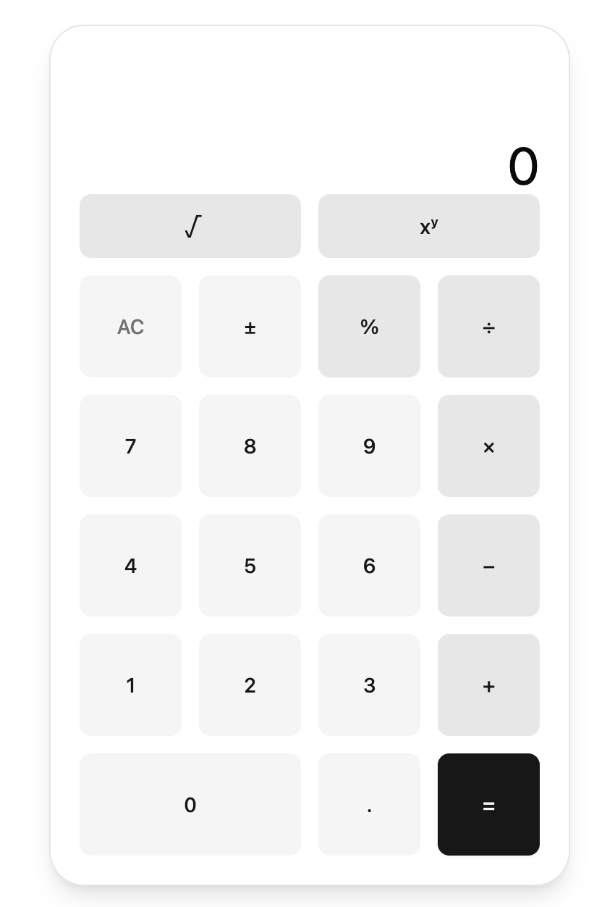

# sezzlecalc

A full-stack calculator — a Go REST API consumed by a React/Vite/TypeScript frontend. The backend is a pure arithmetic domain (`internal/calc`) behind a thin HTTP layer (`internal/httpapi` + `cmd/server`); the frontend is a calculator UI that **validates and formats only** and delegates every computed value to the server.



## Features

- **Calculator:** seven operations — `add`, `subtract`, `multiply`, `divide`, `power`, `sqrt`, `percent` — one binary operation at a time (no chaining or precedence); unary `sqrt`/`percent` evaluate the current entry immediately; keypad plus keyboard input; every result is displayed with at most 12 significant digits; exactly one request is sent per evaluating press.
- **API:** `POST /evaluate` + `GET /health` on plain paths (no `/api` prefix on the server); JSON envelopes `{"result": <number>}` on success and `{"error": "<string>"}` on failure; a compact `400`/`405`/`422`/`500` error taxonomy (see the HTTP API section); an `application/json` `Content-Type` gate and a 1 KiB request-body cap.
- **Architecture:** a pure `internal/calc` domain with no `net/http`; a thin `internal/httpapi` layer with a single error→status mapper; a frontend that validates and formats only and never performs arithmetic; the `api-contract` skill as the single source of truth for the REST contract, so the two layers cannot drift.
- **Packaging:** Docker compose runs the full stack — frontend on `:3000`, backend on `:8080`.
- **Verification:** all gates green — `make check` (backend build/test/vet; frontend 5 test files / 75 tests; lint 0 errors, 1 known warning), backend statement coverage 100.0% (`internal/calc`), 97.9% (`internal/httpapi`), 90.5% module total, 17 backend tests PASS / 0 FAIL / 0 SKIP, `docker compose build` exit 0.

## Architecture

```
┌──────────────────────────────────────────────────────────────────────┐
│                             sezzlecalc                               │
│  backend/  (Go module sezzlecalc/backend, :8080)                     │
│    internal/httpapi     POST /evaluate · GET /health · error mapper  │
│    internal/calc        pure domain: Evaluate · Arity                │
│                          ▲  plain paths, no /api prefix, no CORS     │
│  frontend/  (Vite 7 + React 19 + TS)                                 │
│    lib/          api · validation · format · calculator-machine      │
│   /api/evaluate → dev Vite proxy / prod nginx strip /api → :8080     │
└──────────────────────────────────────────────────────────────────────┘
```

The backend separates a **pure domain** (`internal/calc`) from a **thin HTTP layer** (`internal/httpapi`) and a **thin entrypoint** (`cmd/server/main.go` — `slog` → `httpapi.NewHandler` → `:8080`). The domain never touches `net/http`; the HTTP layer owns encoding, routing, method enforcement, the `Content-Type` gate, the 1 KiB body cap, arity-aware operand presence, panic recovery, and the single error→status mapper, delegating all arithmetic to `calc.Evaluate` (and arity to `calc.Arity`).

The frontend is a **dumb-but-exact** state machine: it never performs arithmetic, so every displayed value originates from a `200 {"result": <number>}` response; the four pure modules under `src/lib/` hold every "smart" decision, and the dev proxy keeps the backend CORS-free.

## Tech stack

- **Backend:** Go (module `sezzlecalc/backend`, minimum `go 1.22`), stdlib-only in production code; tested with the standard `testing` package (table-driven, `-race`, `httptest`). The single third-party dependency is `github.com/stretchr/testify` (test-only, plus its indirect `go.yaml.in/yaml/v3`).
- **Frontend:** Vite 7 + React 19 + TypeScript (strict) + Tailwind v4 + shadcn/ui (`Button`). Testing: Vitest 3 (jsdom) + React Testing Library + `@testing-library/user-event` + `@testing-library/jest-dom`.

## Repository layout

```
sezzlecalc/
├── AGENTS.md / Makefile / PROMPTS.md / README.md / opencode.json
├── calculator-screenshot.png       # the running calculator (referenced above)
├── .gitignore                      # ignores backend/coverage.txt, frontend/dist, node_modules
├── docker-compose.yml              # backend (8080) + frontend (3000:80) services
├── backend/
│   ├── go.mod / go.sum             # module sezzlecalc/backend; go 1.22; testify (test-only)
│   ├── Dockerfile / .dockerignore  # static build → distroless static-debian13:nonroot
│   ├── cmd/server/main.go          # :8080, slog, httpapi.NewHandler, server timeouts
│   └── internal/
│       ├── calc/                   # calc.go + calc_test.go (Evaluate, Arity, sentinels)
│       └── httpapi/                # httpapi.go + httpapi_test.go (NewHandler, mapper)
├── frontend/
│   ├── package.json / package-lock.json   # scripts: dev, build, test, lint, preview
│   ├── Dockerfile / .dockerignore         # node:24-alpine build → nginx:1.30-alpine
│   ├── nginx.conf                  # SPA fallback + /api/ → backend:8080 proxy
│   ├── vite.config.ts              # react + tailwind plugins, @ alias, /api proxy, Vitest block
│   ├── tsconfig.json / tsconfig.app.json / tsconfig.node.json
│   │   + eslint.config.js / components.json / index.html
│   └── src/
│       ├── main.tsx / App.tsx / index.css / vite-env.d.ts
│       ├── components/             # Calculator.tsx + Calculator.test.tsx, Display.tsx, ui/button.tsx
│       ├── lib/                    # utils.ts; api, validation, format, calculator-machine (+ their tests)
│       └── test/setup.ts           # jest-dom + cleanup
├── docs/
│   ├── ai/                         # coverage-summary.md, prompt-log.md, skills.md
│   └── opencode/
│       ├── prds/                   # one PRD per feature
│       │   ├── calc-domain-package.md
│       │   ├── http-api-layer.md
│       │   ├── extra-operations.md
│       │   ├── frontend-calculator.md
│       │   ├── fe-polish.md
│       │   └── docker-packaging.md
│       └── plans/                  # matching implementation plan per PRD
│           ├── calc-domain-package.md
│           ├── http-api-layer.md
│           ├── extra-operations.md
│           ├── frontend-calculator.md
│           ├── fe-polish.md
│           └── docker-packaging.md
└── .opencode/                      # agent harness: agents/, commands/, plugins/, skills/
```

## Prerequisites

- **Go** toolchain `>= 1.22` (the module declares `go 1.22` as its minimum and does not pin a `toolchain` directive).
- **Node.js + npm** (the frontend pins `@types/node@^24`; Node 22/24 is expected — exact patches resolve via `npm install` into `package-lock.json`).
- **make** (the root `Makefile` is the canonical entry point; the underlying `go`/`npm` commands work without it too). **Docker Engine + Compose v2** (`docker compose version` works) is required only for the Docker path.

## Quick start

From the repository root (`make help` lists every target). `make check` runs every gate below — it is green; see Testing & coverage for the recorded results:

```sh
make backend-build      # cd backend && go build ./...
make backend-test       # cd backend && go test -race ./...
make backend-vet        # cd backend && go vet ./... && test -z "$(gofmt -l .)"
make backend-cover      # writes backend/coverage.txt and prints a per-function report
make frontend-install   # cd frontend && npm install
make frontend-test      # cd frontend && npm run test    (= vitest run)
make frontend-lint      # cd frontend && npm run lint    (= eslint .)
make frontend-build     # cd frontend && npm run build   (= tsc -b && vite build)
make check              # all build + test gates above
```

### Run the backend

`cd backend && go run ./cmd/server` starts the server on **`:8080`** (logs to stderr; `ReadHeaderTimeout: 5s`, `ReadTimeout: 10s`, `WriteTimeout: 10s`, `IdleTimeout: 60s`).

### Run the frontend (dev)

`cd frontend && npm install && npm run dev`, then open the URL Vite prints (default `http://localhost:5173`). The dev server proxies `/api/*` → `http://localhost:8080/*` (stripping the `/api` prefix), so the browser never talks to the backend cross-origin. With both layers running, pressing `1 2 × 4 =` shows `48` after a single `POST /api/evaluate` (proxied to `/evaluate`) with `{"operation":"multiply","a":12,"b":4}`; with the backend stopped, the UI still renders and a computed key press shows `Could not reach the server`.

### Docker (full stack)

```sh
docker compose build    # build backend + frontend images
docker compose up -d    # start both containers
docker compose ps       # both should be running
```

Frontend: <http://localhost:3000> (nginx, container port 80) · Backend: <http://localhost:8080> (Go, container port 8080). Verify: open <http://localhost:3000>, press `1 2 × 4 =` → the display shows `48` after exactly one `POST /api/evaluate` (nginx strips `/api` and forwards `/evaluate`). The same path via curl:

```sh
curl -sS -X POST http://localhost:3000/api/evaluate \
  -H 'Content-Type: application/json' \
  -d '{"operation":"multiply","a":12,"b":4}'
# → {"result":48}

curl -sS http://localhost:8080/health
# → {"status":"ok"}
```

Stop and remove the stack with `docker compose down`. The backend reads `PORT` (a bare port number, default `8080`); the compose file sets `PORT=8080`. The API base is inlined into the frontend bundle at build time — after changing `VITE_API_BASE_URL`, rebuild with `docker compose build` (a restart alone does not change it). Base images are pinned (no `latest`, no floating tags): `golang:1.26` (backend builder), `gcr.io/distroless/static-debian13:nonroot` (backend runtime — non-root uid `65532`, no shell), `node:24-alpine` (frontend builder), `nginx:1.30-alpine` (frontend runtime, current stable).

The first proxied request immediately after `docker compose up -d` can briefly return `502 Bad Gateway` — `depends_on` only waits for container start, not for the backend to accept connections (there is no healthcheck, since the distroless image has no shell). Retry once; this is expected, not a defect.

Routing note: production nginx proxies only `location /api/` (trailing slash) and strips the `/api/` prefix before forwarding, whereas the Vite dev proxy matches the bare `/api` prefix and rewrites it away. The app itself only ever emits `/api/evaluate`, so the two behave identically in normal use — but a bare `GET /api` is served the SPA shell (`index.html`, `200`) in production, while the dev proxy forwards it to the backend.

## The `internal/calc` API

Package `calc` (import path `sezzlecalc/backend/internal/calc`) exposes two pure functions and four sentinel errors:

```go
func Evaluate(operation string, a, b float64) (float64, error)
func Arity(operation string) (int, bool)

var ErrDivideByZero     = errors.New("division by zero")
var ErrUnknownOperation = errors.New("unknown operation")
var ErrSqrtNegative     = errors.New("square root of negative number")
var ErrNonFiniteResult  = errors.New("non-finite result")
```

### Operations

| `operation` | Arity | Computation | Notes |
|-------------|-------|-------------|-------|
| `add`       | binary | `a + b` | |
| `subtract`  | binary | `a - b` | |
| `multiply`  | binary | `a * b` | |
| `divide`    | binary | `a / b` | guarded: `b == 0` → `ErrDivideByZero` |
| `power`     | binary | `math.Pow(a, b)` | |
| `sqrt`      | **unary** | `math.Sqrt(a)` | guarded: `a < 0` → `ErrSqrtNegative`; reads `a` only |
| `percent`   | **unary** | `a / 100` | reads `a` only |

- Matching is **case-insensitive** and **whitespace-trimmed** for all seven names: `"Add"`, `" add "`, and `"ADD"` all resolve to `add`.
- Any string that does not normalize to one of the seven canonical names — including `""` and aliases like `"plus"` or `"mod"` — returns `ErrUnknownOperation`.

### `Arity` — the single source of truth for operand count

`Arity(operation)` returns the required operand count, normalized exactly like `Evaluate`: `(2, true)` for the five binary operations, `(1, true)` for `sqrt`/`percent`, `(0, false)` for anything else. `internal/httpapi` holds **no** local operation/unary table, so the two layers cannot drift.

### Error semantics

- Errors are **sentinel values**, matched with `errors.Is` (not `==` or string comparison).
- `divide` with a **zero divisor** returns `(0, ErrDivideByZero)`. The guard is `b == 0`, which also catches `-0.0` (`+0.0 == -0.0`).
- `sqrt` of a **strictly negative** number returns `(0, ErrSqrtNegative)`; the `a < 0` guard runs **before** `math.Sqrt(a)`. `sqrt(-0.0)` is a **finite success** returning `-0.0`.
- A **non-finite result** (`NaN`/`±Inf`) returns `(0, ErrNonFiniteResult)` — detected **in the domain** before it is returned, so `encoding/json` can never receive `NaN`/`±Inf`. It covers e.g. `power(10, 400)`, `power(-2, 0.5)`, `power(0, -1)`, and `multiply(1e308, 10)`.

## HTTP API

The HTTP surface implements the `api-contract` skill (`.opencode/skills/api-contract/SKILL.md`) for all seven operations. The single exported constructor is `func httpapi.NewHandler(logger *slog.Logger) http.Handler` (nil-safe).

### Endpoints

| Method | Path | Success | Purpose |
|--------|------|---------|---------|
| `POST` | `/evaluate` | `200 {"result": <number>}` | Evaluate one arithmetic operation |
| `GET`  | `/health`  | `200 {"status":"ok"}` | Liveness check |

Routes are **plain paths** — there is no `/api` prefix on the server. The frontend's dev proxy adds `/api` on the browser side and strips it before forwarding. The HTTP method is enforced **inside each handler**, so a wrong method returns a JSON `405` (not the mux's default text 405).

### Request — `POST /evaluate`

```json
{ "operation": "add", "a": 1.5, "b": 2.5 }
```

| Field | Type | Required | Notes |
|-------|------|----------|-------|
| `operation` | string | yes | one of the seven operations (case-insensitive, whitespace-trimmed) |
| `a` | number | yes | required for **every** operation |
| `b` | number | binary only | required for `add`/`subtract`/`multiply`/`divide`/`power`; must be **omitted or `null`** for `sqrt`/`percent` (a numeric `b` on a unary op → `400`) |

Transport constraints (checked in order): method must be `POST` (else `405`); `Content-Type` must be `application/json` (else `400`, `charset` allowed); body capped at 1 KiB (else `400`); malformed JSON / empty body / trailing data (else `400`); arity-aware operand presence (else `400`); non-finite input backstop (else `400`); then `calc.Evaluate` runs and domain errors flow through the single mapper.

### Response envelopes

- **Success** (`/evaluate`): `200 {"result": <number>}` — a `result` key and **no** `error` key. The result is a raw JSON number (no server-side rounding).
- **Health**: `200 {"status":"ok"}`.
- **Error**: `{"error":"<string>"}` with **no** `result` key.

### Error taxonomy

Exactly one unexported function — `writeError` — maps errors to `(status, message)`; it is the **only** place an error string meets a status code.

| Status | `error` string | Trigger |
|--------|----------------|---------|
| `400` | `invalid input` | non-JSON/absent `Content-Type`, malformed JSON, empty body, trailing data, missing/`null`/wrong-typed operands, numeric `b` on a unary op, non-finite input, body > 1 KiB |
| `405` | `method not allowed` | wrong HTTP method on `/evaluate` or `/health` |
| `422` | `division by zero` | `divide` with `b == 0` (including `-0.0`) |
| `422` | `square root of negative number` | `sqrt` of a strictly negative number |
| `422` | `invalid operation` | unknown/empty `operation` |
| `422` | `non-finite result` | result overflows to `±Inf`/`NaN` |
| `500` | `internal error` | panic recovery / unexpected error |

### curl examples

Run the server first (`cd backend && go run ./cmd/server`), then in another terminal. These hit the backend directly at `:8080` (its plain paths, no `/api` — the `/api` prefix is a dev-proxy concept on the frontend side only):

```sh
# add → 200 {"result":4}
curl -i -X POST http://localhost:8080/evaluate \
  -H 'Content-Type: application/json' \
  -d '{"operation":"add","a":1.5,"b":2.5}'

# subtract → 200 {"result":3}
curl -i -X POST http://localhost:8080/evaluate \
  -H 'Content-Type: application/json' \
  -d '{"operation":"subtract","a":5,"b":2}'

# multiply → 200 {"result":12}
curl -i -X POST http://localhost:8080/evaluate \
  -H 'Content-Type: application/json' \
  -d '{"operation":"multiply","a":3,"b":4}'

# divide → 200 {"result":4}
curl -i -X POST http://localhost:8080/evaluate \
  -H 'Content-Type: application/json' \
  -d '{"operation":"divide","a":8,"b":2}'

# power → 200 {"result":1024}
curl -i -X POST http://localhost:8080/evaluate \
  -H 'Content-Type: application/json' \
  -d '{"operation":"power","a":2,"b":10}'

# sqrt (unary — b omitted) → 200 {"result":3}
curl -i -X POST http://localhost:8080/evaluate \
  -H 'Content-Type: application/json' \
  -d '{"operation":"sqrt","a":9}'

# percent (unary — b omitted) → 200 {"result":0.5}
curl -i -X POST http://localhost:8080/evaluate \
  -H 'Content-Type: application/json' \
  -d '{"operation":"percent","a":50}'

# divide by zero → 422 {"error":"division by zero"}
curl -i -X POST http://localhost:8080/evaluate \
  -H 'Content-Type: application/json' \
  -d '{"operation":"divide","a":5,"b":0}'

# sqrt of a negative → 422 {"error":"square root of negative number"}
curl -i -X POST http://localhost:8080/evaluate \
  -H 'Content-Type: application/json' \
  -d '{"operation":"sqrt","a":-1}'

# unknown operation → 422 {"error":"invalid operation"}
curl -i -X POST http://localhost:8080/evaluate \
  -H 'Content-Type: application/json' \
  -d '{"operation":"mod","a":2,"b":3}'

# invalid input (numeric b on a unary op) → 400 {"error":"invalid input"}
curl -i -X POST http://localhost:8080/evaluate \
  -H 'Content-Type: application/json' \
  -d '{"operation":"sqrt","a":9,"b":2}'

# invalid input (missing Content-Type) → 400 {"error":"invalid input"}
curl -i -X POST http://localhost:8080/evaluate \
  -d '{"operation":"add","a":1,"b":2}'

# health → 200 {"status":"ok"}
curl -i http://localhost:8080/health
```

The error envelope is always `{"error":"<string>"}` with no `result` key; `curl -i` includes the status line and headers. A `divide` result such as `8 / 2 = 4.0` marshals as `4` (Go's `float64` JSON formatter), so assert the decoded number, not the exact bytes.

## Frontend — architecture

The frontend is Vite 7 + React 19 + TypeScript strict, styled with Tailwind v4 and shadcn/ui (a single `Button` component). All "smart" behavior lives in four pure `src/lib` modules; `Calculator.tsx` is the wiring.

- **`src/lib/validation.ts` — the entry guard and operation metadata.** The single source of binary-vs-unary truth: the `BinaryOperation`/`UnaryOperation` types, the `BINARY_OPERATIONS`/`UNARY_OPERATIONS` arrays, the `isBinaryOperation`/`isUnaryOperation` type guards, the `ENTRY_PATTERN` regex, and `parseEntry(raw: string): number | null` — the one guard between the display buffer and the wire. It accepts `12`, `-5`, `3.`, `0.`, `.5`, `1e+21`, `1.5e-9`, `-0`; it rejects empty/whitespace, `'-'`, `'.'`, `'abc'`, `'0x10'`, `'1,000'`, `'Infinity'`, `'NaN'`, and non-finite `'1e999'`. A `null` result blocks any request.
- **`src/lib/format.ts` — the display rule.** One function, `formatNumber(value: number): string`, with `MAX_SIGNIFICANT_DIGITS = 12`: `value.toPrecision(12)` with trailing zeros (and a trailing `.`) stripped, `-0` → `'0'`, exponents preserved. JS's `toPrecision` switches to exponential form at exponent ≥ 12 or < −6, giving compact scientific notation for very large/small magnitudes. Applied **exactly once** per computed value, never during typing.
- **`src/lib/api.ts` — the never-throwing request client.** `evaluate(request): Promise<EvaluateOutcome>` with `EvaluateOutcome` = `{ ok: true; value: number } | { ok: false; error: string }`. It **never throws or rejects**: it posts to `EVALUATE_URL` (`${API_BASE_URL}/evaluate`) with `Content-Type: application/json` and a 10 s abort. On a 2xx it reads `result` (must be a finite number, else transport error); on a 4xx/5xx it reads `error` (a non-empty string, rendered **verbatim**); any thrown/rejected path (network, abort/timeout, non-JSON body) returns `TRANSPORT_ERROR` = `'Could not reach the server'`. The `EvaluateRequest` union (`{operation, a, b}` binary / `{operation, a}` unary) makes sending `b` to `sqrt`/`percent` a type error.
- **`src/lib/calculator-machine.ts` — the state machine.** A pure reducer module (no React, no `fetch`, no DOM): `DisplayStatus` (`editing | awaiting | result | error | busy`), `CalculatorState`, `INITIAL`, the `Action` union, and `reducer`. Digits/`.` build the entry (at most one decimal point); `±` toggles the sign as text only; `AC` resets to `INITIAL`; Backspace removes the last character (keyboard-only); a binary operator stores `lhs` and selects the operation (replacing, never evaluating); `begin`/`resolve` commit an evaluation — `=` with `preserve: false`, `√`/`%` with `preserve: true` (keeping a pending `lhs`/`operator`). While `busy`, every transition except `clear` is ignored, guaranteeing **exactly one** request per evaluating press.
- **`src/components/Calculator.tsx` — wiring, keypad, keyboard.** `useReducer(reducer, INITIAL)` plus a `requestToken` ref for staleness: `evaluateCurrent` builds the request, bumps the token, dispatches `begin`, and on resolution dispatches `resolve` only if the token is still current (`clear` bumps the token to invalidate any in-flight response). One `window` keydown listener maps digits, `.`, `+ - * /`, `Enter`/`=`, `Backspace`, and `Escape`. The key grid is 4 columns × 6 rows (a two-key scientific strip `√ xʸ` above the keypad, `0` spanning two columns, operators rightmost); all 21 keys are real `<button type="button">` with unique accessible names.
- **`src/components/Display.tsx` — the display.** A presentational `<output>` with `aria-label="Calculator display"` and `data-testid="calculator-display"`. On `status === 'error'` it renders `role="alert"` and **drops `aria-live` entirely** (one assertive + atomic live region, no double announcement); in every non-error state it keeps `aria-live="polite"` and no `role`. Text precedence: error → the `error` string (falling back to `Unknown error`), empty entry → `0`, otherwise the entry. Size thresholds: ≤10 characters renders `text-4xl`, else `text-2xl`; an error renders `text-lg break-words`.

## Design decisions & assumptions

### Backend

- **Module path `sezzlecalc/backend`**, `go 1.22` minimum with no `toolchain` directive; production code is stdlib-only; `testify` is test-only.
- **Sentinel errors over dynamic strings**, matched with `errors.Is`.
- **Pure, stateless domain separated from HTTP**; `Evaluate` and `Arity` are pure functions; all error→status mapping lives in one `writeError` method.
- **Non-finite result detection lives in the domain** (so `encoding/json` never sees `NaN`/`±Inf`), while non-finite *input* is a `400 invalid input` at the boundary.
- **Plain-path routing with in-handler method enforcement**; `mime.ParseMediaType` Content-Type gate; `http.MaxBytesReader` 1 KiB cap; panic recovery logging server-side only.

### Frontend

- **12 significant digits** — `formatNumber` renders at most 12 significant digits via `toPrecision(12)`; JS's own exponential thresholds (exponent ≥ 12 or < −6) produce compact scientific notation.
- **`-0` → `0`** — negative zero is normalized to `0` in the display (`value === 0` also matches `-0` in JS); `±` never produces `-0`.
- **Percent is a bare ratio** — the contract defines `percent(a) = a / 100`, so `50 %` shows `0.5` (no `%` suffix) and no sign symbol is sent as an operation.
- **Precision trade-off on chained calculations** — computed values are stored in `entry` already formatted (12 significant digits), so a chain uses the *displayed* value: `1 ÷ 3 =` shows `0.333333333333`, then `× 3 =` yields `0.999999999999`. This is accepted; there is no hidden exact-value field.
- **`VITE_API_BASE_URL` is a base prefix** — it defaults to `/api` and has trailing slashes stripped; the full endpoint is `${base}/evaluate`. It is not a full endpoint URL. Setting it to `http://localhost:8080` would bypass the proxy and fail CORS (the backend has no CORS middleware) — documented but unsupported. No `.env` file is committed.
- **The dev proxy is mandatory** — `/api/*` → `/*` to `http://localhost:8080`, so `/api/evaluate` reaches `/evaluate`. Omitting the `rewrite` produces 404s.
- **Assertive (not polite) error announcement** — the single display element swaps to `role="alert"` and drops `aria-live` only while `status === 'error'`; `role="alert"` is inherently assertive *and* atomic, so this is one live region with no double announcement. Non-error announcements (digits, results) stay polite.
- **44 px minimum tap targets** — every key carries `min-h-11` (44 px) so the spanning `√`/`xʸ` keys (which have no square sibling to size the row) reach the ≥44×44 target; square keys are unaffected (58 px). At a 320 px viewport there is no horizontal scroll.
- **Stale results never survive an error** — the reducer clears `entry`/`lhs`/`operator` on every failed resolution, and retry is manual re-entry (a digit after an error starts a fresh calculation and issues a new request).

## Testing & coverage

### Backend

- `internal/calc` tests are **table-driven** (`t.Run` per case), asserting value and error via `errors.Is`, covering all seven operations, normalization, `0`/`-0.0`, every non-finite case, `sqrt` of a negative, `Arity`, and a concurrency test under `-race`. `internal/httpapi` tests drive `NewHandler` end-to-end through `httptest`, asserting **status code + envelope shape + exact decoded value** — all seven operations, the full error taxonomy, arity-aware presence rules, the `Content-Type` gate, the 1 KiB cap, wrong methods, panic recovery, and negative-zero results.
- `make backend-cover` reports **100%** for `internal/calc`, **97.9%** for `internal/httpapi`, and a **90.5%** module total. The only uncovered statements are two defensive non-finite-input backstop guards (unreachable over the wire because JSON cannot express `NaN`/`Inf`) plus `cmd/server/main.go` — untested by design (thin wiring, including the `PORT` read). A fresh `go test -race -count=1 -v ./...` run records **17 PASS / 0 FAIL / 0 SKIP**.

### Frontend

- **Vitest 3 + React Testing Library + `@testing-library/user-event` + `@testing-library/jest-dom`**, `environment: 'jsdom'`; `fetch` is always stubbed, so no test performs real network I/O. Five test files, **75 tests** (`make frontend-test` = `vitest run`, non-interactive):
  - `Calculator.test.tsx` — component behavior scenarios: the binary path sends exactly one `POST /api/evaluate` `{operation:'multiply', a:12, b:4}` and renders `48`; the unary `sqrt` path posts `{operation:'sqrt', a:9}` with no `b` key and renders `3`; an empty entry blocks the request (`fetch` is never called). Plus: no request on mount, sign toggle, verbatim server errors, `AC` clearing an error, `busy` disabling keys, operator replacement, unary-preserves-pending-operator, keyboard entry, the assertive error announcement (`role="alert"`, `aria-live` dropped), stale-result clearing, transport-failure UX (message renders, keypad re-enables, non-JSON 2xx included), and retry after an error.
  - `calculator-machine.test.ts` — reducer unit tests: a failed `resolve` clears `entry`/`lhs`/`operator` even with `preserve: true`; a digit after `error` returns to `editing`.
  - `api.test.ts` — api-client status/transport handling: `200` success, `422`/`400`/`500` verbatim errors, network failure, abort, non-JSON bodies, and a 2xx without a finite numeric `result`, all resolving (never rejecting) to the exact expected outcome, plus the request init (`POST`, `Content-Type`, no `b` key on unary).
  - `validation.test.ts` — `parseEntry` accept/reject tables and the binary/unary metadata + type guards. `format.test.ts` — the `formatNumber` 12-significant-digit table (`48 → '48'`, `-0 → '0'`, `1/3 → '0.333333333333'`, `1e12 → '1e+12'`, `1e-7 → '1e-7'`, `Infinity → 'Error'`, …).
- Lint: `make frontend-lint` (`eslint .`) reports **0 errors**; one known `react-refresh/only-export-components` **warning** on the shadcn `buttonVariants` export (a warning, not an error).

See [`docs/ai/coverage-summary.md`](docs/ai/coverage-summary.md) for the full per-function backend breakdown and the frontend breadth summary.

## AI-assisted development

This project was developed with AI assistance; the curated prompt trail is [`PROMPTS.md`](PROMPTS.md) and the complete raw log is [`docs/ai/prompt-log.md`](docs/ai/prompt-log.md).
